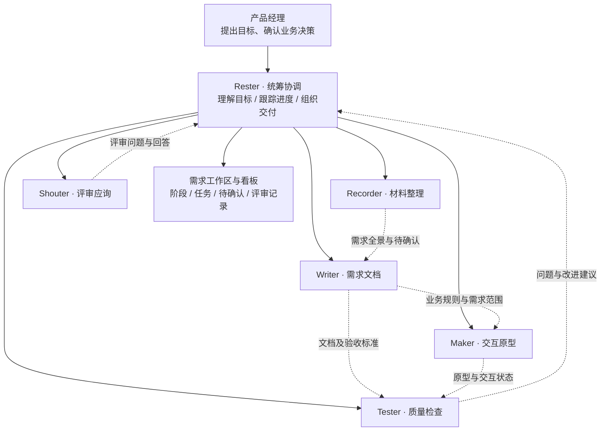
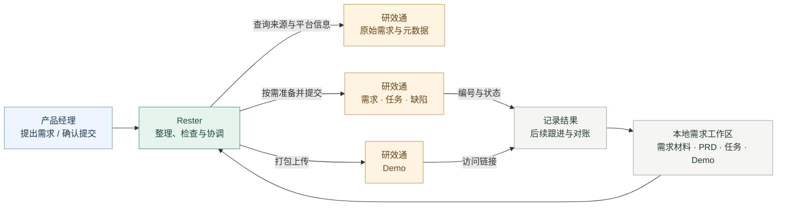
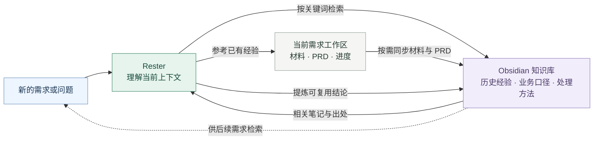
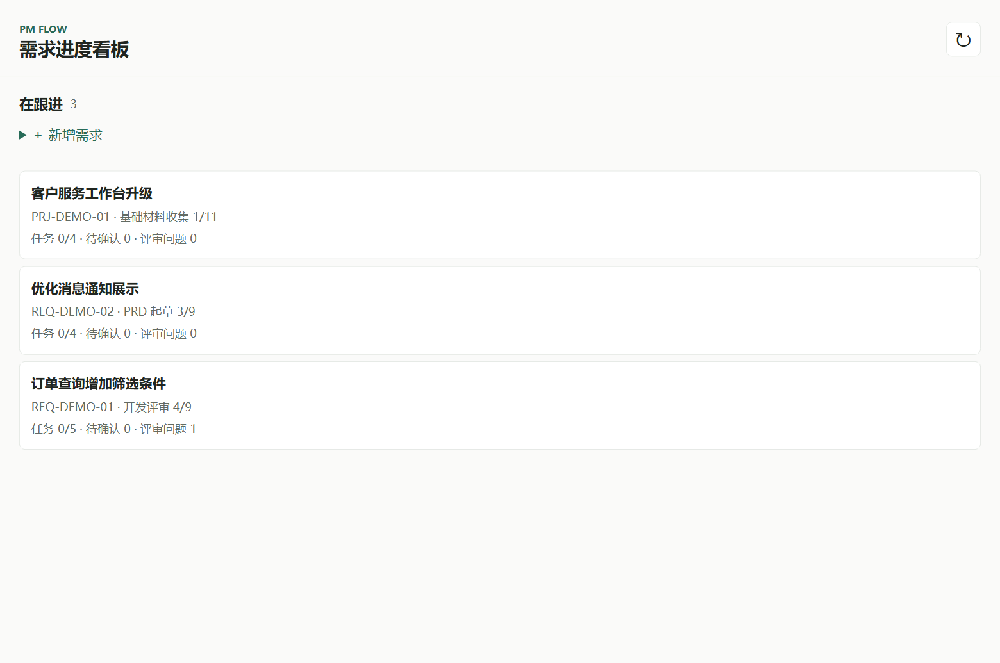
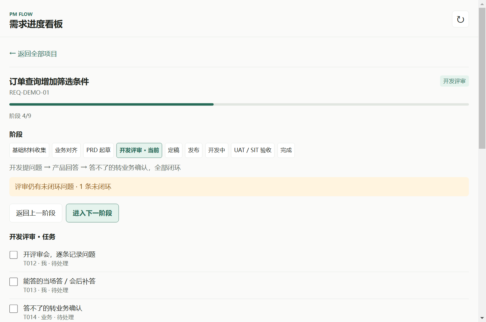

# Rester 产品需求工作台

**把零散的材料、需求进度和评审问题，整理成一条可持续跟进的工作线。**

Rester 面向产品经理的日常需求工作，覆盖基础材料收集、业务对齐、PRD、原型、开发评审和验收。你可以直接用自然语言交代任务，由 Rester 根据需要协调不同角色；需求状态和材料保存在自己的工作区中，便于下次接着做。

---

## 六个角色如何配合

**你主要与 Rester 对话。** 它先了解目标和需求状态，再根据工作内容协调另外五个角色；简单事项也可以由 Rester 直接处理。业务决策和重要交付由人确认。



角色之间是按需协作，并非每个需求都必须经过全部角色。是否启动独立子会话，取决于所使用的宿主和可用能力。

| 角色 | 适合交给它什么 | 带回什么 |
| --- | --- | --- |
| **Rester · 统筹协调** | 理解你的目标、查看进度、协调角色、跟踪任务与评审，按需处理研效通交付 | 当前状态、下一步建议、待你确认的事项 |
| **Recorder · 材料整理** | 阅读会议纪要、业务材料和已有文档，梳理诉求、参与方、约束与信息冲突 | 需求全景、材料要点、待确认问题和任务线索 |
| **Writer · 需求文档** | 起草或更新 PRD，梳理业务规则、拆分模块及子需求 | 可评审的需求文档、验收要点和未决事项 |
| **Maker · 交互原型** | 根据已明确的需求制作或调整 HTML 交互 Demo | 页面与交互原型，以及尚未覆盖的场景说明 |
| **Shouter · 评审应询** | 面对开发或业务提问时查阅材料，梳理有依据的回答并跟进问题 | 可用于沟通的答复、待业务确认的问题及评审记录 |
| **Tester · 质量检查** | 检查 PRD、原型和验收要点的一致性，寻找遗漏或冲突 | 问题清单与修改建议，供你决定如何处理 |

一次典型的大需求可能是：Recorder 先整理材料，Writer 梳理规则并编写 PRD，Maker 将规则转为可交互原型，Tester 检查覆盖和一致性，Shouter 协助回答评审问题；Rester 贯穿全程，维护进度并协调后续工作。小需求可以只使用其中需要的环节。

## 研效通：让本地工作与团队协作衔接

启用研效通后，Rester 可以围绕本地需求工作区查询平台信息、准备交付内容，并按需发起平台操作。你可以先在本地梳理需求和任务，再确认要提交的内容；完成后，平台编号和相关状态可用于后续跟进与对账。



| 工作场景 | Rester 可以协助 |
| --- | --- |
| **需求梳理** | 查询原始需求和平台元数据，整理故事卡的优先级、故事点及需要人工处理的预警。 |
| **需求与任务交付** | 根据本地材料准备需求内容，将需要交给开发的任务推送到平台，并记录成功返回的编号。 |
| **原型评审** | 将本地 HTML Demo 打包上传，获取平台返回的访问链接。 |
| **测试与缺陷** | 根据验收中发现的问题创建缺陷，并按需更新缺陷状态。 |
| **进度核对** | 查询本地工作区记录的需求、任务、Demo 和缺陷的关联情况，帮助核对哪些已处理、哪些仍待处理。 |

例如，你可以说：“先查一下这条原始需求，整理成故事卡”，“把需要开发处理的任务准备好给我确认”，或“验收发现了这个问题，帮我准备缺陷单”。

研效通是可选集成，需要选择环境并完成本机认证。实际操作受平台接口、账号权限及环境影响；某些事项仍需在平台页面手动完成，例如设置上级需求、上传 Word 附件，以及处理插件未提供接口的评审单或迭代管理。平台写入以用户确认的内容和实际返回结果为准。

## Obsidian：把经验带到下一个需求

启用 Obsidian 后，Rester 可以从你的知识库中查找相关经验，也可以把值得复用的业务口径、踩坑记录和处理方法沉淀为笔记。当前需求的正式材料仍保存在工作区，知识库用于保存副本、索引和提炼后的经验。



| 工作场景 | Rester 可以协助 |
| --- | --- |
| **开始新阶段** | 按阶段相关关键词查找已有经验，为当前工作提供参考。 |
| **回答业务或开发问题** | 检索以往的结论和出处，提醒你核实其适用范围与时效。 |
| **沉淀经验** | 将可复用的业务口径、系统限制或处理方法整理成结构化笔记。 |
| **整理需求档案** | 按需把当前工作区的材料和 PRD 同步为知识库副本，方便后续查阅。 |

例如，你可以说：“以前有没有遇到类似问题？”，“把这次确认的业务口径记下来”，或“把这个需求的材料同步到我的知识库”。

Obsidian 是可选集成，需运行 Obsidian 并配置 Local REST API。知识检索主要依靠关键词，未命中不代表知识库里一定没有相关内容；连接不可用时，仍可继续使用本地工作台。

## 能帮你完成哪些工作

### 从材料到需求

把会议纪要、现有文档和业务背景交给 Rester，梳理核心诉求、参与角色、规则冲突和待确认事项。材料不足时，尚未确认的内容会被标记出来，避免把假设写成结论。

### 从需求到可评审产物

协助撰写或更新 PRD、拆分模块和子需求，整理验收要点，也可以根据明确的规则制作交互 Demo。评审前可检查文档、原型与验收内容之间的遗漏或不一致。

### 跟进进度和评审

一个需求对应一个本地工作区。阶段、任务、待确认事项和评审记录随工作保存；你可以在看板中手动更新，也可以在对话中让 Rester 记录。AI 在后续读取工作区时可以看到看板上的修改，但不会向空闲对话主动推送实时通知。

## 看板：先看到全局，再进入细节

打开看板，先查看正在跟进的需求及其阶段、任务和评审情况，也可以直接新增需求。



进入某个需求后，可以查看各阶段的信息、勾选任务、添加任务和待确认事项，或根据实际进度推进、返回阶段。仍有未处理事项时，看板会展示相应提示。



> 截图展示的是 Codex 本地浏览器看板，所有名称和数据均为示例。DeepSeek Harness 的看板入口和界面可能有所不同。

## 开始使用

复制下面这句话发给你的 Agent，让它帮你安装：

```text
请帮我安装并配置 Rester 产品需求工作台（https://github.com/THEM-bot/SXF_Rester）：先识别当前宿主并检查 Node.js 20 或以上、现有安装和本地改动，复用已有仓库或克隆仓库并安装依赖；在 DeepSeek Harness 中通过插件管理器把仓库目录安装为 bundle，在 Codex 中运行仓库的 codex/install-skill.mjs 安装 skill；保留现有配置和未提交改动，不覆盖同名 skill；引导我选择已有需求工作区父目录，以及是否启用研效通和 Obsidian，并通过仓库提供的设置功能保存我确认的选项；凭据由我通过本机安全方式配置，不要让我粘贴到聊天中；最后检查安装结果，说明需要重启的步骤，并在 Codex 中按需启动本地浏览器看板，遇到缺少权限、访问仓库失败或无法自动完成的步骤时明确告诉我。
```

<details>
<summary>手动安装与首次配置</summary>

需要 **Node.js 20 或更高版本**。先将本仓库克隆到本机，在插件目录安装依赖；更新仓库后请按需重新安装依赖并重启宿主。

**DeepSeek Harness**：在 DeepSeek Assistant 中，让插件管理器把克隆目录安装为本地 bundle，然后重启应用。安装成功后，可从应用侧栏打开需求进度看板。

**Codex**：在克隆目录中让 Codex 执行 `node codex/install-skill.mjs` 安装 skill，再重启或重新打开 Codex。安装程序不会覆盖已有的同名 skill；移动插件目录后需要重新安装。

Codex 看板是本地浏览器页面，而非 Codex 原生固定侧栏入口。需要查看时，可以让 Codex 启动本仓库的 `codex/server.mjs` 并打开看板。

首次使用时，Rester 会引导你选择已存在的需求工作区父目录，并询问是否启用研效通和 Obsidian。启用研效通后，还需通过平台提供的本机登录方式配置环境和凭据；启用 Obsidian 时，需要运行 Obsidian、配置 Local REST API 和宿主环境变量 `OBSIDIAN_API_KEY`。集成选项之后也可以修改。

配置保存在当前用户的本机用户目录。请勿把 token 或 API Key 发到聊天中；完成配置不等于认证成功，实际连接还需检查。

</details>

<details>
<summary>使用示例</summary>

安装后，可以这样说：

- “帮我新建一个需求，整理这些会议材料。”
- “我正在跟进哪些需求？有哪些事情在等别人确认？”
- “根据现有材料起草 PRD，把业务规则和待确认项分开。”
- “为这个需求做一个可交互的 Demo，再检查是否覆盖 PRD。”
- “开发评审提出了这些问题，帮我整理答复并记录下来。”
- “看看这个需求距离验收还缺什么。”

</details>

## 数据与使用边界

需求工作区和本地配置由使用者自行管理和备份。使用研效通、Obsidian 或模型服务时，相关内容会按所使用服务的配置和权限进行处理，请遵循公司的数据使用要求。插件不是多人实时协作系统，多人同时修改同一工作区时需自行协调。

Rester 可以辅助整理信息、发现问题和准备交付，但不能替代业务负责人对范围、规则、优先级及验收结论的判断。

## 许可证

插件采用 MIT 许可证。内置的 Archify 组件另附许可证及第三方声明，请一并遵守。
