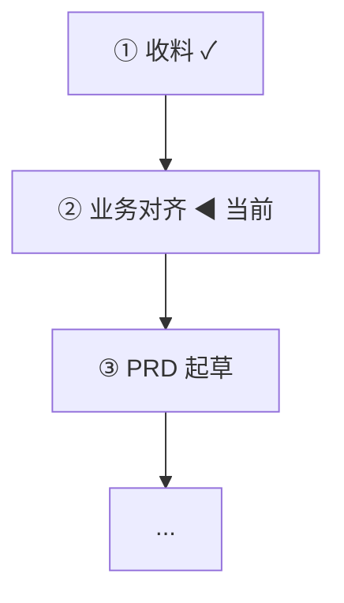
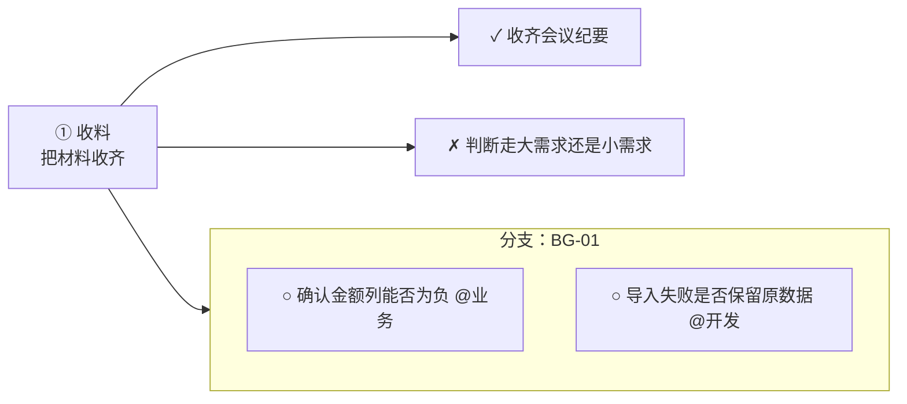

# pm-flow：产品经理工作流

**这个 skill 只做两件事：告诉你现在该做什么，和帮你把产物写对。** 所有状态由 `tools/pmw.mjs` 落盘管理，不靠记忆。

## 零、先确认在哪干活

```bash
ROOT="<本 skill 所在目录>"     # 含 SKILL.md 的那一层
node "$ROOT/tools/pmw.mjs" ls           # 看有哪些项目
node "$ROOT/tools/pmw.mjs" today        # 今天该干什么（最常用）
```

Windows 下路径用反斜杠并加引号：`node "D:\...\pm-flow\tools\pmw.mjs" today`。
**不要 `cd` 进项目目录再跑**，统一用 `--dir "项目目录"` 指定项目。

---

## 一、第一件事永远是看图

用户问"到哪一步了/该干什么"，先跑：

```bash
node "$ROOT/tools/pmw.mjs" status --dir "<项目目录>"
```

它输出 Mermaid 流程图 + 当前阶段 + 下一个动作 + 门禁没过的项。**把 Mermaid 原样贴进回复**，用户就是靠这个看进度的。

只要图不要文字用 `pmw flow`。

---

## 二、两条主线，别走错

**一个需求 = 一个工作区目录**。用户会在 `D:\Users\SXF-Admin\Desktop\文档\` 下自己建目录、把材料放进去，
然后说「这个需求开始走流程」。这时用 **`init --here`** 就地在那个目录落状态，**不要另建子目录**。

| 用户说的事 | 走哪条 |
| --- | --- |
| 在现有系统上描述哪里不对、加字段、加校验、改文案 | **小需求** |
| 描述一样新东西该长什么样、新建/重构系统 | **大需求** |

```bash
pmw init --here --kind project --title "预算系统重构" --dir "D:\Users\SXF-Admin\Desktop\文档\预算系统改造需求"
pmw init --here --kind req --title "导入模板加一列" --dir "<工作区>"
```

拿不准就问一句：「这次是新建/重构系统，还是在现有系统上加东西？」
**判错的代价很大**：小需求硬走大需求，半天填不完；大需求走小需求，后面拆不动。
判错了不用重建：`pmw back` 或 `pmw goto` 改过去即可。

- 大需求 11 段：`P1_INTAKE → P2_DISCOVERY → P3_MASTER_PRD → P4_MODULE_SPLIT → P5_MODULE_PRD → P6_DEMO → P7_PUBLISH → P8_DEV_REVIEW → P9_BUILD → P10_UAT → DONE`
- 小需求 9 段：`S1_INTAKE → S2_ALIGN → S3_PRD → S4_DEV_REVIEW → S5_FINAL → S6_PUBLISH → S7_BUILD → S8_UAT → DONE`

---

## 三、每进入一个阶段，先读该阶段的写作指引

```bash
node "$ROOT/tools/pmw.mjs" guide            # 当前阶段怎么写
node "$ROOT/tools/pmw.mjs" guide P3_MASTER_PRD
node "$ROOT/tools/pmw.mjs" guide list
```

**不要凭印象写 PRD**。指引里写的是这个岗位真实的写作纪律（哪节给谁看、验收怎么写、哪些话不能写）。

**`guide` 会自动带上这个阶段相关的历史经验**：它拿阶段对应的检索词去知识库捞一遍，命中就在指引末尾列出笔记路径和摘要（最多 5 篇，跳过「什么算XX」说明页和两个索引页）。知识库没连上就静默跳过，不影响主流程；不想等就加 `--no-kb`。看到有命中的，先扫一眼再动笔——那多半是你自己以前踩过的坑。

---

## 四、命令速查

### 启动与推进
| 命令 | 作用 |
| --- | --- |
| `init --here --kind project --title "标题"` | **就地在当前工作区**建大需求 |
| `init --here --kind req --title "标题"` | 就地在当前工作区建小需求 |
| `init --kind project --id PRJ-01 --title "标题"` | 在父目录下新建 `<id>/` 子目录 |
| `board` | 看板：所有在跟的需求（阶段进度 / 本阶段任务完成度 / 挂在别人手上） |
| `brief` | 巡检：谁手上压了几天 / 卡点挂了多久 / 哪个需求停着不动（`--all` 看全部，`--wait-days 2` 调阈值） |
| `status` / `flow` / `today` | 看进度图 / 只看图 / 待办清单 |
| `next` / `advance` | 下一步是什么 / 推进（门禁不过会拦） |
| `goto <阶段>` / `back <阶段> --reason "..."` | 跳到指定阶段 / 退回 |
| `history` | 阶段流转记录 |

### 自我反思与改路线（治"走错方向没人拦"）
| 命令 | 作用 |
| --- | --- |
| `reflect` / `reflect status` | 看当前这轮的反思问题和处理情况 |
| `reflect start [--focus "字段口径"]` | 开一轮反思：按当前阶段给出 3–4 条问句，供逐条回答/记问题 |
| `reflect add "问题" [--sev hard\|soft] [--where 文件]` | 把反思里发现的问题记进本轮 |
| `reflect fix <编号\|all>` / `reflect keep <编号> --reason "..."` | 已修 / 决定不修（必须给理由） |
| `reflect close [--force]` | 收尾本轮（还有未处理项会被拦） |
| `reroute` | 路线体检：给出「该退回 / 该升级 / 该改主线」的提议（只提议不动手） |
| `reroute apply <编号>` / `reroute dismiss <编号>` | 采纳 / 忽略某条提议 |
| `since [--last-ai] [--by user]` | 上次你看见之后发生了什么（谁改的、改了什么） |
| `ack` | 承认已看到这些改动（水位推进，不再重复提醒） |

### 大需求专用
| 命令 | 作用 |
| --- | --- |
| `split` | 从总 PRD 的模块表自动建模块 |
| `add-module --id MOD-01 --title "预算台账"` | 手动加模块 |
| `add-sub --id BG-01 --module MOD-01 --title "导入预算" --deps BG-00 --batch B1` | 加子需求 |
| `sync-docs` | 重建 `modules/index.md` 父子索引 |

### 评审问题台账（治"评审完不知道漏了什么"）
```bash
pmw review add "金额列能填负数吗" --who 张三
pmw review list                 # open + deferred 一屏看完
pmw review answer 1 "不能，负数走追加预算"
pmw review defer 2 --to 业务    # 答不了的立刻挂给业务
pmw review close 3
```
**评审时开发提的每个问题都要进台账**，当场答了也要 `close`，否则下次记不住答没答。

### 卡点
```bash
pmw block "导出金额差 0.01"    ;  pmw unblock 1
```

### 任务链路（每阶段有哪些活、卡在谁手上）
每个阶段预置了标准任务，`init` 时自动播种。对话里推进事情时，**顺手把任务状态改掉**——这是流程图像"活的"的唯一来源。

```bash
pmw task list                    # 本阶段任务（--all 全部，--who 业务 只看某人的）
pmw task add "确认金额列能为负吗" --who 业务 --branch BG-01   # 加一条临时任务
pmw task add "导入失败要回滚吗" --stage P4_MODULE_SPLIT --branch 异常流程 --branch-kind scenario
pmw task done T005               # 做完（--note "…" 记一句）
pmw task doing T006              # 开始做
pmw task block T007 --note "等老板批"  # 卡住；reopen 恢复
pmw task who T008 业务           # 改「这事得找谁确认」
pmw task branch T009 BG-02       # 挂到某个支线
pmw task branches                # 按支线看
pmw task pending                 # 按人汇总：要找人确认什么
pmw task seed                    # 老项目补标准任务
pmw taskflow                     # 只出本阶段任务链路图（--stage P4_MODULE_SPLIT 看别的阶段）
```

**支线（branch）只有两种分法**：按模块/子需求（`BG-01`、`MOD-02`）、按场景（`正常流程`、`导入失败`、`权限不足`）。不要用职能当支线。

**会议纪要导入**：`pmw digest 某纪要.docx --extract --stage P2_DISCOVERY` 会把「待确认/待明确」抽成待确认项挂到「问谁确认」，把「XX 负责/跟进」抽成任务。抽不全的再由你补 `task add`。

### 文档转换与发布
| 命令 | 作用 |
| --- | --- |
| `digest` | **不给参数就递归扫整个工作区**，把 docx / xlsx / pdf 全转到 `原材料/` |
| `digest <文件或目录>` | 只转指定的 |
| `digest --extract` | 同时从纪要抽出任务与待确认项 |
| `doc <in.md> <out.docx>` | 单个 Markdown 转 Word（自动目录/页眉/页码） |
| `doc <in.md> --pdf` | 出 Word 的同时再出一份 PDF（外发、给主管看用） |
| `doc --no-toc` | 不生成目录 |
| `check` | 一致性体检（缺文件/依赖成环/缺验收/待确认项 + 字段叫法/验收覆盖/demo 覆盖） |
| `lint` | 只跑一致性那一半：字段叫法统一吗 / 规则有没有验收覆盖 / demo 与 PRD 对得上吗（写 PRD 时顺手跑） |
| `publish` | 全部产物转 Word 到 `产物/` + 生成 `publish-plan.json` |
| `clean [--dry] [--all]` | 删掉中间 md，只留 `产物/` 里的 Word（`--dry` 先看要删什么，`--all` 连 `changelog.md` 一起删） |
| `pushed <编号> --no REQ-20261106-11` | 回填研效通编号 |

### 表格与 PDF（读 Excel、出 PDF）
| 命令 | 作用 |
| --- | --- |
| `xlsx sheets <f.xlsx>` | 这个表有几个 sheet、各多少行列 |
| `xlsx read <f.xlsx> [--sheet 名] [--out p.md]` | 读成 Markdown；不给 `--out` 直接打印 |
| `xlsx write <spec.json> <out.xlsx>` | 按 spec 写表（表头灰底、冻结表头、自动筛选、列宽） |
| `import --from xlsx <f.xlsx> [--dry]` | **按表批量建模块 + 子需求**，表头按关键词自动认列 |
| `export --to xlsx` | 把需求总览 / 任务链 / 评审台账导成 Excel 到 `产物/` |
| `pdf read <f.pdf> [--pages 1-5] [--out p.md]` | PDF 转 Markdown（去页眉页脚、合并断行） |
| `pdf make <f.md> [--out x.pdf]` | Markdown 出 PDF（A4、微软雅黑、表格有边框） |
| `sys list` / `sys show <key> [--reveal]` / `sys open <key> [--env UAT]` | 公司系统清单：有哪些系统、各环境地址、账号（默认遮住密码） |

### 跑 shell 命令（用这个，不要用 PowerShell）
| 动作 | 作用 |
| --- | --- |
| `sh cmd="..."` | 在 Git Bash 里跑，支持多行 / \&\& / 管道 / heredoc |
| `sh cmd="..." timeoutMs=600000` | 长命令调超时（默认 120 秒） |
| `sh cmd="..." background=true` | 丢后台，立刻返回 `jobId` |
| `sh action=jobs` | 看所有后台任务 |
| `sh action=job jobId=sh-1` | 看某个任务的输出和状态 |
| `sh action=stop jobId=sh-1` | 停掉 |

### 知识库（Obsidian 长期记忆）
| 动作 | 作用 |
| --- | --- |
| `obsidian action=status` | 连没连上、里面有哪些需求 |
| `obsidian action=recall query=关键词` | **先搜再答**，别凭印象 |
| `obsidian action=remember title="结论" category=pitfall content="..."` | 记一条经验 |
| `obsidian action=sync` | 把当前工作区的材料与 PRD 镜像进知识库 |
| `obsidian action=tree path=需求知识库` | 看目录 |
| `pmw note status` / `note sync` / `note search <词>` / `note init` | 同一件事的命令行版（`init` 幂等地建索引页） |

### 研效通（平台对账）
| 动作 | 作用 |
| --- | --- |
| `pmw yxt doctor` | 自检：包找到没、token 还有效吗、六个子包齐不齐 |
| `pmw yxt config --business-domain-id xxx --project-id yyy` | 存一次默认值，以后建需求不用再问四五个问题 |
| `pmw yxt status` | 这个需求在平台上对到哪了（REQ / 任务推了几条 / demo 链接 / 缺陷） |
| `pmw yxt req REQ-xxx` | 查一条需求，拿平台 id（建任务/缺陷都要它） |
| `pmw yxt task push [--dry]` | **把给开发的活推成平台任务，挂在需求下** |
| `pmw yxt task new --req REQ-xxx --title "..."` | 单条建任务 |
| `pmw yxt demo push [--mode d03\|d04]` | demo 打包上传，回 accessUrl |
| `pmw yxt defect new --title "..." [--severity]` | UAT 不过就建缺陷 |
| `pmw yxt defect status TD-xxx --to "修复待回归"` | 推缺陷状态 |
| `pmw yxt or new\|link` | 原始需求：建一条，或记下已有编号 |
| `pmw yxt todo new --desc "..." --owner 工号` | 组织待办（领导交办、跨团队跟进） |
| `pmw yxt problem --title "..." --submitter 姓名` | 问题单 |
| `pmw yxt meta task m10 --pick phase` | 查元数据（阶段 / 类别 / 业务领域 / 严重程度） |

**所有写操作都先加 `--dry` 看一遍 body 再真发**。生产库不是沙箱，建错了要手工去删。

**知识库里有两个 Dataview 索引页**：`00-索引/需求总览`（所有在跟的需求按阶段排）和 `00-索引/工作台`（等谁 / 卡点 / 停滞 / 经验）。它们由查询实时算出来，**不要手工往里面加行** —— 加进去也会显示不出来，因为表格体是查询渲染的。要改就改数据（需求笔记的 frontmatter），不要改表格。

---

## 四之二、需要另一种视角时：派角色，或先补业务背景

### 六个角色（每个都是「两三门手艺叠起来的老手」）

| 角色 | 技能 | 什么时候派 |
| --- | --- | --- |
| **Recorder** 收料 | `pm-recorder` | 刚进来一堆材料，要还原「要做什么、有哪些活、找谁、哪里冲突」 |
| **Writer** 写 PRD | `pm-writer` | 要写/改 PRD、要拆模块 |
| **Maker** 做 Demo | `pm-maker` | 要把 PRD 变成能点的东西 |
| **Shouter** 应询 | `pm-shouter` | 开发/业务来质疑，要一个能发出去的说法 |
| **Tester** 挑错 | `pm-tester` | 要一份「必须改 / 你拍板」的清单 |
| **Rester** 调度 | `pm-rester` | **默认入口**：判断该谁上、管节奏、推研效通 |

派活用 `pm_role`：`{ action:"list" }` → `{ action:"prompt", role:"maker", dir:"<工作区>", task:"<一句话>" }` → 把返回的 prompt 原样交给 subagent。

**小事不用派。** 你自己用 `pm_flow` 直接干更快；派角色是**为了换一个专业视角**，不是为了走流程。

### 业务背景不够时，先读 `pm-domain`

`pm-domain` 是业务域档案：系统全景（OMS/ERP/盘古供/ATP/MDM/BI 各管什么）、一条订单从报价到核销的完整链条、
五个「型号」的区别、库存与供应能力的六个口径、财经结账节奏、这张网里每个人关心什么、术语词典、
七类常见需求的标答结构、什么叫「这个需求做对了」。

**这些不是当前需求的结论，是背景常识。** 与实际材料冲突时，以材料为准并把冲突提出来。

写立项报告、写 PRD 背景、跟人解释「这两个数为什么不一样」之前，先过一遍它。

---

## 五、铁律（违反必出问题）

1. **先看状态再说话。** 任何关于"走到哪了/下一步"的问题，先跑 `status`，不要凭聊天下结论。
2. **一次只推一个阶段。** 不要跳步，`advance` 会做门禁检查；门禁不过就补产物，不要 `goto` 硬跳过去。
3. **评审问题当场记账。** 答不了的立刻 `review defer --to 业务`，这是最容易漏的一环。
4. **PRD 改了必须记 `changelog.md` 并重新 `publish`。** 版本对不上是核心痛点，留痕是唯一解法。
5. **推需求池用研效通 CLI，不要手填表单。** 但有两件事开放 API 做不到，必须提醒用户去 Web 手工补：
   - **设上级需求**（R01 没有 parent 字段）
   - **传 Word 附件**（需求包无附件能力）
   
   这两步可以自己用 `browser` 去做，但**要用户先确认**：`browser` 到需求详情页 → snapshot → 报出要点哪个元素 → 用户同意后再点。
6. **docx 不能直接读**，先 `pmw digest` 转文本。
7. **不确定就标 `[待确认]`**，不要编。编出来的规则开发会照着做。
8. **对话推进时顺手改任务状态。** 用户说「这个做完了 / 已经问过了 / 老板批了」→ 立刻 `task done`；说「这个还得问 XX」→ `task who`。**不要等用户自己点**，任务状态不动，图就是死的。
9. **新冒出来的活立刻 `task add`。** 聊着聊着发现要做的事（「还得确认下导出格式」），当场加一条并挂到支线，别攒着。
10. **Windows 上跑 shell 用 `sh` 工具（bash），不要用 PowerShell。** 见下一节。
11. **答过的问题先查知识库，再凭印象。** `obsidian action=recall query=<关键词>`；查到就用，查到过时的就顺手改。答完若这条经验对以后也成立，`obsidian action=remember` 记一条（见「五之四」）。
12. **没人问也要主动巡检。** 用户没提需求时，别干等他开口：`brief` 看谁手上压着事、哪个需求停着。**等着别人超过 2 天就该催，不要等他自己想起来。**
13. **写 PRD 前后各跑一次 `lint`。** 字段叫法漂移（`生效时间` vs `变更时间`）和「有规则没验收」是评审时最容易被开发挑出来的两类硬伤，机器能查的就别留给人工。
14. **推进前先反思一轮。** 写 PRD、拆模块、做 demo、发出去之前，`reflect start` 拿问句对着稿子走一遍。**问题是给稿子找证据的，不是给自己打勾的**；开了不处理的轮次会拦住 `advance`。
15. **动手前先 `since`。** 用户可能在面板上自己改过阶段、勾过任务、答过评审。**先看清「上次我离开之后发生了什么」，再决定下一步**——不然你会拿旧判断覆盖用户的操作。
16. **路线是人的判断，工具只摆证据。** `reroute` 给你的只是提议（该退回 / 该升级 / 该改主线）；把理由讲给用户听，他点头再 `reroute apply`。

---

## 五之一、跑命令：用 `sh`，不要用 PowerShell

这个插件带一个 `sh` 工具，底层是 Git Bash。**在这台 Windows 上，任何 shell 操作优先走它。**

**为什么**：PowerShell 有一串谁都记不住的坑，agent 撞上去就是一个命令反复失败——
`&&` 老版本不认、中文参数变乱码、写文件带 BOM 让下游 JSON 解析失败、
嵌套引号被解析器吃掉、管道捕获子进程输出直接 EPERM。
bash 这些都没有。它不是「另一种风格」，是「少出事」。

**用法**：

```
sh  cmd="ls -la"                      列目录
sh  cmd="grep -rn 关键字 ."            找内容
sh  cmd="node script.mjs"             跑脚本
sh  cmd="npm install" timeoutMs=600000 background=true
                                      长任务丢后台，之后 sh action=job jobId=sh-1
sh  action=jobs                       看所有后台任务
sh  action=stop jobId=sh-1            停掉
```

**写法对照**（记住这几个就够）：

| 想干的事 | 用这个 | 别用 |
| --- | --- | --- |
| 列目录 | `ls -la` | `Get-ChildItem` |
| 递归找文件 | `find . -name '*.md'` | `Get-ChildItem -Recurse` |
| 搜索内容 | `grep -rn 'x' .` | `Select-String` |
| 看文件前 40 行 | `head -n 40 f` | `Get-Content -TotalCount` |
| 环境变量 | `$HOME` `$PATH` | `$env:HOME` |
| 串联命令 | `a && b` | `a; if ($?) { b }` |
| 重定向 | `> f` | `> f`（同形但编码不同） |

**路径**：`D:\Users\x` 在 bash 里是 `/d/Users/x`，或者直接写 `"D:/Users/x"`。反斜杠是转义符，别用。

**长输出**：会自动保留开头 + 结尾、中间省略。要看全的就 `> /tmp/x.log` 重定向再分页读。

**失败了**：非零退出码会自动附一段诊断（找不到命令 / 路径不存在 / 引号没配对 / CRLF 换行），
直接照着改，不要原样重试。

**危险命令会被拦**：`rm -rf`、`git push -f`、`git reset --hard`、`npm publish` 等会返回「需要用户确认」，
把命令给用户看、等他说可以，再带 `confirmed=true` 重发。**不要自己绕过。**

**什么时候还是得用 PowerShell**：只有需要 Windows 原生 API（注册表、服务、ACL、COM）时，
在 `sh` 里显式写 `powershell -Command "..."`，别换工具。

---

## 五之三、出 Word：不用写 Python

PRD 源文件是 Markdown，`pmw publish` 一键出 Word。**引擎是 docx@9，不是手写 OOXML，也不是 Python。**

**Markdown 里能用的排版**（够写 PRD）：

| 写法 | Word 里变成 |
| --- | --- |
| `# 标题` ~ `#### 标题` | Heading 1-4，进导航窗格、自动进目录 |
| `- 项目` / `1. 编号` | 项目符号 / 编号列表（多级） |
| `\| 表格 \|` | 灰底表头 + 细边框表格 |
| 单元格里写 `^^` | **向上合并**（纵向合并到上一行） |
| 单元格里写 `>>` | **向右合并**（横向合并到左格） |
| `<br>` | 单元格内换行 |
| `---` | 分页符 |
| `***` | 水平分隔线 |
| `> 引用` | 左侧竖线 + 浅灰底引用块 |
| ```` ``` ```` 代码块 | 等宽字体 + 灰底 |
| `` | 内嵌图片，**自动编号成「图 1 说明」** |
| `[文字](链接)` | 可点超链接 |

**自动加的东西**（不用你写）：目录域（Word 打开后右键「更新域」出页码）、页眉（文档标题）、页脚（第 N 页 / 共 M 页）、中文字体微软雅黑。

**标题层级约定**：`#` = Heading 1 = 大纲一级。文档大标题不由 `#` 表示，`pmw doc --title "..."` 给；`publish` 用需求编号+标题。这样 md ↔ Word 往返不会丢级。

**表格合并实例**：
```markdown
| 字段名称 | 来源 | 产品规则 |
| --- | --- | --- |
| 变更型号 | 盘古供 | 新旧配置对比的唯一识别键，必填 |
| ^^       | OMS   | 下单时按变更型号匹配，匹配不到则拦截 |
| 合计     | >>    | >> |
```

**读回**：`node tools/lib/docx.mjs x.docx --out x.md`。合并单元格、`<br>`、链接都能还原（标题写成 `<!-- title: ... -->` 注释，不占章节层级）。

### 插图

PRD 里要放图（demo 截图、竞品截图、现有系统界面、流程图），就在 md 里写一行：

```markdown

```

出来的 Word 是：图片**居中、按比例撑满版心宽（约 600px）、下方自动编号图注「图 1 导入预算页整体布局」**。图注跟着图不跨页，后面正文可以直接写「见图 1」。

**控制大小**（在括号后加花括号）：

| 写法 | 效果 |
| --- | --- |
| `` | 撑满版心（比版心小的图**不放大**，避免糊） |
| `{400}` | 宽 400，高按比例 |
| `{400x220}` | 指定宽高 |
| `{50%}` | 版心宽度的一半 |
| `` | 只出图，不要图注，也不占图号 |

**路径怎么找**：依次试 ① 相对 md 文件所在目录 ② 相对工作区根 ③ 当前目录。所以图放 `shots/`、`images/`、或跟 md 同级都行。

**图片从哪来**：
1. 用户给路径 → 直接写进 md
2. 需要系统截图 → `browser action=screenshot filePath=<工作区>\shots\xxx.png`，落盘到工作区，再在 md 里引用（模型还要 `read_image` 自己看一眼，确认没截错）
3. 已有图片 → 让用户丢进工作区，`pmw check` 会告诉你哪些引用找不到

**别做的事**：不要写 http 外链（Word 不会内嵌）、不要用 webp（Word 不支持，先转 png/jpg）。这两种 `pmw check` 都会提醒。

**出问题怎么看**：找不到的图会在 Word 里显示红色「[图片缺失] 说明 路径」，同时 `pmw publish` / `pmw check` 会列出试过哪些位置。

---

## 五之二、浏览器：能自己去看页面

插件带一个 `browser` 工具，直接接管本机 Chrome（CDP 直连，不用装 Playwright）。**需要看真实页面时才用**，纯读文档别用。

**什么时候用**：
- 推研效通需求池之后，去 Web 界面**设上级需求、传 Word 附件**（开放 API 做不到，只能人工点）
- 抓需求池/迭代任务列表，回填到工作区
- 看企微文档、demo 页面实际长什么样（截图 + 自己看图，确认排版对不对）
- 开发说「你在系统里看看就知道了」——自己去点

**标准走法（先看再动手）**：
```
browser action=snapshot                 → 拿到 @e1/@e2… 编号和页面文字
browser action=click ref=@e7            → 点编号
browser action=fill ref=@e3 text=...    → 填
browser action=screenshot               → 存 PNG，再用 read_image 打开那个路径真看图
browser action=screenshot filePath=<工作区>\shots\导入页.png   → 直接存进工作区，好写进 PRD
```

**三条硬规矩**：
1. **每个动作前先 snapshot。** SPA 点一下整块重渲染，`@eN` 编号全部作废；拿旧编号点会明确报错，重新 snapshot 就行。
2. **点「提交/保存/删除/通过/发送」这类按钮，工具会拦下来要确认。** 这时**把元素文字报给用户，等他说可以**，再用 `confirmed=true` 重发。不要自己绕过。
3. **截图落盘后必须真的 `read_image` 看它**，不要只看「已截图」就下结论。

**连不上时**：`browser action=launch` 起一个带调试端口的 Chrome（profile 在 `%USERPROFILE%\.dsh\browser-profile`，登录一次研效通/企微就一直留着）。日常模式下它就是你的浏览器。

**要打开公司系统时，先问 `pmw sys`**：`sys list` 看有哪些系统、`sys open pangugong --env UAT` 直接拿地址、`sys show oms` 看账号（密码默认遮住，真要登录时加 `--reveal`）。
安全边界：**默认只连测试/UAT；生产环境只读，不动任何数据。**

---

## 五之二、读表、出 PDF：不用再让人手工抄

### 读 Excel
用户手里的系统导出表、需求池录入清单、评审问题清单，多半是 xlsx。

```
pmw xlsx sheets <f.xlsx>                     → 先看有几个 sheet，叫什么
pmw xlsx read <f.xlsx> --sheet "BG与模块对应"  → 读成 Markdown，表格结构保留
pmw digest                                   → 不给参数就扫整个工作区，xlsx 一起转进 原材料/
```

读的时候注意三件事：**合并单元格**（excel 里一个标题横跨几列，转出来只有第一格有值）；**空值**（显示成空格，不是 0，别自己补 0）；**日期**（按样式判断，转成 `2026-11-07`，不是 46000 那串序列号）。

### 一次性建几十条子需求
拿到「模块录入清单」这种表，不要一条条 `add-sub`：

```
pmw import --from xlsx <f.xlsx> --sheet "BG与模块对应" --dry   → 先看它认出来的列和要建的东西
pmw import --from xlsx <f.xlsx> --sheet "BG与模块对应"         → 真建
```

表头靠关键词自动认列：`编号`（排除含「模块」的列）、`交付项`/`标题`、`模块需求标题`、`所属模块编号`、`建议批次`、`前置BG`。认错了就用 `--id-col 0 --title-col 1 --module-title-col 3` 这样的参数直接指定列号（从 0 开始）。
**依赖只认跟编号同前缀的**（表里 BG-01 的前置写 `T-01对应条件` 这种备注会被忽略，不会建出自相矛盾的依赖）。

### 出 PDF
```
pmw doc prd.md --pdf            → Word + PDF 各一份
pmw pdf make prd.md            → 只要 PDF（默认落 产物/）
pmw pdf read 合同.pdf           → PDF 转 Markdown，进上下文
```
PDF 用 Chrome 排版渲染，没有 LibreOffice 也能出，中文字体跟着一起嵌进文件（发给别人不会跑版）。
**读 PDF 的边界**：文字版没问题；扫描件（整页是图）读出来是空的，这种情况让人给 Word/Excel 原文。

---

## 五之四、知识库：Obsidian 当长期记忆

插件带一个 `obsidian` 工具，读写用户的 Obsidian vault（路径见 `pmw note status`）。**它不是产物仓库，是「下次还能用上」的记忆。**

**分工**：
| 放哪 | 放什么 |
| --- | --- |
| 工作区 `prd.md` / `产物/*.docx` / `req.json` | **真相源**：这个需求的正式内容与状态 |
| Obsidian `需求知识库/` | **副本与提炼**：材料摘要、需求索引、可复用经验 |

**两个索引页是 Dataview 查询，别往里手工加行**：`00-索引/需求总览`（按阶段排）与 `00-索引/工作台`（等谁 / 卡点 / 停滞 / 经验）。表格体是渲染出来的，手工加的行不会出现在结果里。要让索引页变，改需求笔记的 frontmatter（`pmw note sync` 会自动写 `stageName` / `progress` / `waiting` / `openReviews` / `blockers`）。

**五个动作**：
```
obsidian action=status                                   → 连没连上、里面有哪些需求
obsidian action=recall query=受控仓                       → 先搜再答，别凭印象
obsidian action=remember title="标题就是结论" category=pitfall content="现象/为什么/下次怎么办"
obsidian action=sync                                     → 把当前工作区的材料与 PRD 镜像进去
obsidian action=read path=需求知识库/20-经验/踩坑与限制/xxx.md
```

**它作为检索层的工作方式（这点要清楚）**：走的是 Obsidian 自带全文检索（关键词/BM25），**不是向量检索**。所以：

- 查**专有名词**很准（受控仓、挑库、未备未发、报价单创建日期）——这个业务里大部分问的都属这类
- 查**换了说法的同义表达**会漏——同一个东西写成「备货/挑库/锁库」时，三个词分别查
- 一次 `recall` 只回最多 8 篇的摘要片段，不会把整库灌进上下文
- **进阶段时自动捞一遍**：`pmw guide` 会按阶段对应的检索词查知识库，命中就列在指引末尾

**记什么（四类）**：
- `pitfall` 踩坑与限制 —— 接口/字段/工具为什么不能用、报什么错、怎么绕
- `rule` 业务口径 —— 口径之争的结论，要写谁定的、什么时候定的、为什么
- `dev` 领域规则 —— 从界面看不出来的隐含约束
- `howto` 写法与流程 —— 这个工作流本身的心得

**不记**：某个需求的具体需求描述（在工作区 prd.md）、一次性会议安排、状态数据（在 req.json）。

**三条铁律**：
1. **标题就是结论**。✅「研效通 R01 没有父需求字段」 ❌「研效通需求池踩坑记录」
2. **必写「下次怎么办」**。只写现象的经验等于没写。
3. **一条只讲一件事**；有出处就写（哪个需求、哪次评审、谁说的）。

**什么时候动手**：阶段推进前 / 答完开发的问题后 / 验收复盘后。一次一条，顺嘴说一句「顺手记进知识库了」即可，不要为记账停下主线。

知识库连不上（没开 Obsidian / 没配 `OBSIDIAN_API_KEY`）时**不要卡住流程**：提示一句，继续干活。

---

## 五之六、研效通：本地是工作台，平台是团队看得到的那份

### 为什么值得接

研效通的开放 API 有一个硬限制，正是你最痛的点：**创建需求（R01）没有任何 parent 字段**，
也就是说**子需求挂不到父需求下**，PRD 的 Word 附件也传不上去（这两个只能在 Web 界面手工补）。
但**任务（T01）可以挂所属需求**——这是全部接口里唯一能自动表达层级关系的地方。

所以分工是：
- **需求本身**：本地写 PRD → `pmw publish` 出 Word → 你去平台手工建/补附件（一条命令省不掉这一段）
- **任务链**：本地 `pmw task add` 记的活 → `pmw yxt task push` 直接推成平台任务，挂在需求下
- **demo**：本地 HTML → `pmw yxt demo push` 打包上传，回一个 accessUrl 直接发人
- **缺陷**：UAT 不过 → `pmw yxt defect new` 建缺陷单，修完推状态

### 推任务前必须知道的两个前提

1. **需求必须已挂开发迭代。** 否则平台会拒：`需求尚未关联开发迭代，请先为需求设置开发迭代`。
   这不是参数写错，是平台上还差一步：需求详情 → 编辑 → 设置开发迭代。
2. **只推"给开发的活"。** `pmw yxt task push` 默认**跳过流程模板任务**（收料、对齐、写 PRD 这些是你自己的活），
   只推你另外用 `pmw task add` 记下的、还没完成的任务。要连模板一起推才加 `--all`。

### 常用节奏

```bash
pmw yxt doctor                          # 第一次先自检
pmw yxt config --business-domain-id ... # 存一次默认值
pmw yxt req REQ-20261107-0014           # 认一下平台上的那条需求
pmw yxt task push --dry                 # 先看 body，确认无误
pmw yxt task push                       # 真推，平台单号自动回填进 req.json
pmw yxt demo push                       # 出 accessUrl，发开发/主管
pmw yxt status                          # 回头对账：本地和平台对不对得上
```

### 连不上怎么办

`pmw yxt doctor` 会一路告诉你卡在哪：找不到包（`pmw yxt config --root "..."`）/
没 token（`~/.yanxiaotong/tokens/prod`）/ 子包不全 / token 过期（doctor 会真连一次验证）。
**不要自己去猜路径**，doctor 已经把常见位置都探过了。

## 五之五、巡检与一致性：替用户盯住他盯不住的东西

### `brief` —— 主动巡检（治"不知道哪些事压着"）

```bash
pmw brief --dir <工作区>          # 只看这一个需求
pmw brief --all                   # 所有在跟的需求
pmw brief --wait-days 1 --block-days 1 --stale-days 3   # 调阈值
```

三件事按「该不该现在动手」排：`⏳ 在等别人`（超期标 ⚠）/ `⛔ 卡点` / `🐢 阶段停滞`，末尾给「✅ 今天可以推的」。

**默认阈值：等别人 2 天、卡点 3 天、阶段停滞 5 天**。这里的「等」只算真挂在别人手上的事——
`review defer --to 业务` 的问题 + `task doing` 且负责人不是「我」的任务。**没发生的模板任务不算**（否则会虚报成「业务×3、主管×2」）。

什么时候看：
- 用户问「最近有什么要跟的 / 有哪些压着」
- 用户一段时间没提某个需求
- 每天早上第一次接手时

**看到超期不要只列出来**：挑最该催的那条，给出具体动作（「这条在肖美玲手上 3 天了，要不要我拟一句话发她」）。

### `lint` —— 一致性体检（治"口径对不上、规则没验收"）

```bash
pmw lint --dir <工作区>
```

查三类，**只报不拦**（`check` 会把它并进去，但不影响 `advance` 门禁）：

| 查什么 | 怎么判 | 级别 |
| --- | --- | --- |
| 字段叫法漂移 | 总 PRD 定义表里的标准名 vs 各文档表头/首列；同后缀不同词干（`生效时间` vs `变更时间`）、同词干不同后缀（`变更日期` vs `变更时间`） | 问题 / 提醒 |
| 规则有没有验收 | 规则表行数 vs 唯一 `-AC0x` 验收条数（只查子需求 PRD，总 PRD 与模块 PRD 是文档不是交付单元） | 提醒 |
| demo 与 PRD 覆盖 | `demo/*.html` 里的 `data-feature="BG-01"` vs PRD 里的编号 | demo 多做=问题，PRD 有 demo 没做=提醒 |

**写 PRD 前跑一次**（看总 PRD 定了哪些标准字段）、**写完再跑一次**（看有没有漂）。做 demo 时给每个功能块加 `data-feature="BG-01"`，覆盖率这就自动有了。

---

## 五之七、反思、改路线、谁改的：让 agent 别一条道走到黑

这个插件原来最缺的不是命令，是**回头看**。三件事补上了：

### 一、自我反思循环（`pmw reflect`）

反思不是规则检查——规则是「有没有填」，反思是「这句是不是我愿意在评审会上念出来的」。

`pmw reflect start` 会按当前阶段给出 3–4 条问句，每条都带一句 hint 说明「什么算好答案」。举例（S3_PRD）：

- 规则表里每一行，我能不能举出一个具体的算例？（hint：举不出算例，说明这行规则还没想清楚，写下来只是填空。）
- 有没有哪一句写的是「与 XX 保持一致」？（hint：这一句等于没写。要么把规则抄过来，要么写明不一致时谁优先。）
- 字数够多的那些段，是我在想事情，还是在凑版面？

流程只有三步：**开一轮 → 逐条记问题 → 处理完收尾**。

```
pmw reflect start --focus 字段口径
pmw reflect add "变更型号为空时怎么判" --sev hard --where 3.2
pmw reflect fix 1
pmw reflect keep 2 --reason "业务已明确这版不做，纪要有记录"
pmw reflect close
```

**硬规矩：还有未处理项时 `advance` 会被拦**。这不是仪式感——评审时被问住的那个问题，八成就在你跳过的问句里。

### 二、自动改路线（`pmw reroute`）

六条信号会被自动识别（退出太多次 / 小需求其实是大需求 / 拖着等业务太多 / UAT 卡住 / 阶段停滞 / 有模块但没有子 PRD），每条都带证据：

```
pmw reroute            # 看有什么提议
pmw reroute apply 2    # 采纳第 2 条（会留痕：谁改的、改之前在哪）
pmw reroute dismiss 3  # 不采纳
```

**只提议、不自动执行**。因为路线是你的判断：工具看到「退回 3 次了」，但只有你知道那次退回是必要的。AI 判断、用户点头、才动手——这三步缺一个都会让人不敢用。

### 三、谁改的（`pmw since` / `pmw ack`）

面板现在可写：用户能自己推进阶段、勾任务、答评审、开反思。所以模型必须能回答一句：**「我不在的时候，谁动了什么？」**

```
pmw since              # 上次查看之后的改动，标 用户 / AI
pmw since --last-ai    # 只看用户干的
pmw ack                # 我看到了（水位推进）
```

`status` 末尾也会自动提醒「⚠ N 条改动发生在你上次查看之后（其中 M 条是用户手动改的）」。

**看到 `用户` 标签的改动，第一反应是「他为什么这么改」，不是「把它改回去」。**

### 面板上能做什么

左侧「需求进度看板」不再是只读的：

| 位置 | 能点的 |
| --- | --- |
| 顶部操作条 | 推进到下一阶段 / 同步知识库 / 体检 |
| 「你上次查看之后」卡片 | 我已知晓（= `ack`） |
| 「反思」卡片 | 开一轮反思 / 收尾本轮 / 再开一轮 |
| 「路线」卡片 | 按这条改 / 忽略 |
| 任务链每行 | ✓（标记完成） |

面板上的所有写操作都走白名单，且强制记成 `--by user`——**AI 和用户改的东西在历史里永远分得开**。

---

## 六、进度图长什么样

**两张图**：总览（阶段级）+ 本阶段任务链路（按支线展开）。





- 总览图：`✓` 过了、`◀ 当前` 现在、灰的没到；回退边（验收不过回评审、评审不清回对齐）也在图上。
- 任务链路图：`✓` 做完、`▶` 进行中、`○` 待办、`✗` 卡住；`@业务`/`@主管`/`@开发` 是**该找谁确认**。
- 左侧面板把两张图 + 「要找人确认」清单一起渲染，对话里只需说「已更新」。


---

## 七、目录结构（一个需求 = 一个工作区目录）

状态和材料**平铺在同一个目录**里，不是藏在子目录里：

```
D:\Users\SXF-Admin\Desktop\文档\配置切换需求\      ← 用户自己建的目录，名字随便
  project.json          状态机（阶段、评审、卡点、子需求、任务、研效通编号）
  会议纪要.docx          用户放的原始材料（放哪都行，可以有子文件夹）
  原材料/               digest 转出来的 md
  discover.md           梳理与对齐
  master/master-prd.md  总 PRD
  modules/MOD-01/{module-prd.md, subs/BG-01/prd.md}
  demo/                 原型 HTML
  changelog.md          改动说明（开发靠这个对齐）
  产物/                 publish 出的 Word
```

- 父目录由插件配置 `root` 决定（当前 `D:\Users\SXF-Admin\Desktop\文档`）。`pmw board` 在这里面找所有在跟的需求。
- `已完成`、`归档`、`其他资料`、`PM_skill` 这几个目录会被跳过，不当成需求。

---

## 八、完整走一遍（大需求）

```bash
R="D:\...\pm-flow\tools\pmw.mjs"
W="D:\Users\SXF-Admin\Desktop\文档\预算系统改造需求"     # 用户已建好、材料已放好
node $R digest --dir "$W"                  # 递归扫工作区，docx 全转成 原材料/*.md
node $R init --here --kind project --title "预算系统重构" --dir "$W"
node $R guide P2_DISCOVERY
# …写 discover.md…
node $R advance
node $R guide P3_MASTER_PRD
# …写 master/master-prd.md，含模块表…
node $R split && node $R check
node $R advance
# …逐模块写子 PRD…
node $R review add "..." --who 张三
node $R publish
# …用研效通 CLI 建需求，回填编号…
node $R pushed parent --no REQ-...
node $R status
```
